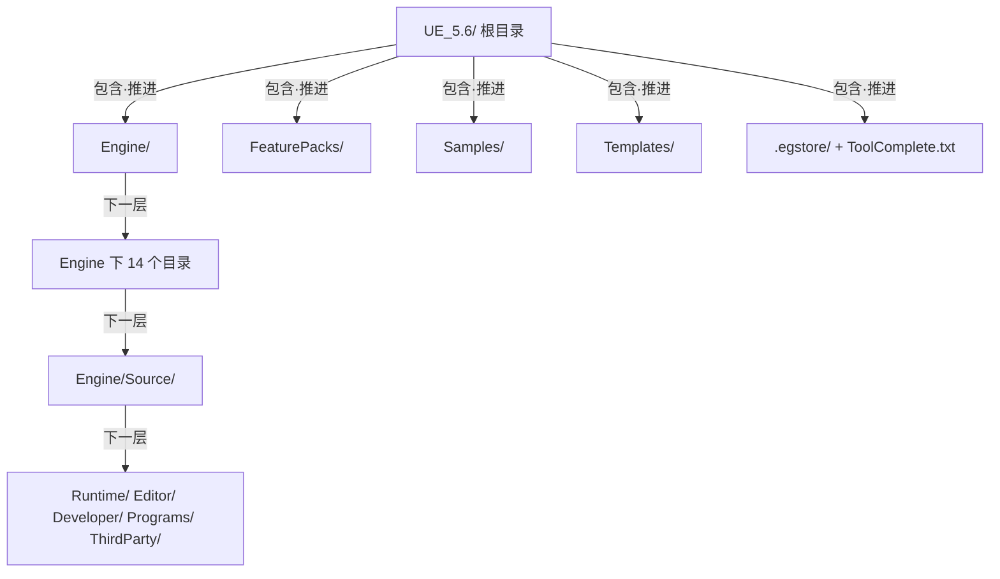

# 从零一比一复刻 UE5.6 —— 学习路径总纲（按真实目录·自上而下）

> **定位**：本文件是 `AI_Learning_Notes\从零复刻ue5\` 的总入口 + 全景地图。2026-11-14 启用。
> **版本**：v1.0｜核心：**从 `UE_5.6\` 这一层开始教**，按引擎真实目录自上而下，读一个、建一个，一比一复刻。
> **口径依据**：`教学经验_UE5复刻新对话必看\00_主要经验.md`（新对话必读；旧 50 份经验已归档）。
> **原则**：不改名、不简化、注释中文化、只教不写代码、一步一 md 一步一反馈。

---

## 一、为什么从 `UE_5.6\` 顶层开始（先讲为什么）

| 维度 | 旧路线（已归档） | 新路线（本教程） |
|---|---|---|
| 复刻对象 | Lyra 示例项目 | `D:\ue5\Epic Games\UE_5.6` 引擎本体 |
| 教学单元 | Lyra 的 26 个文件夹 | **UE5 真实目录树**，从根目录这一层起 |
| 顺序依据 | 依赖链自下而上 | **真实目录自上而下**（从根到叶子） |
| 名字 | `Lyra` → `Tenkaichi` 前缀替换 | **零改名**，保持引擎原名 |
| 产物 | `Tenkaichi` 工程 | `ue_5.6\` 下同名同层级的文件 |

**说个场景**：这就像照着一栋大楼的原始图纸复刻——先把「`UE_5.6`」这块门牌和它下面的几扇门原样立起来，再推门进去、逐层照抄每一间房。门牌不先立，后面每个文件都没有确定落点，就会出现旧路线里最怕的事：文件乱放、后期整批移动。所以第一步不是挑一个类抄，而是**把根目录这一层一比一建出来**。

> **记忆点（考点）**：`UE_5.6\` 是唯一根；这一层连目录带文件全都要照原样建，名字一个字不改。

---

## 二、核心原则（沿用，不因换对象而变）

- **一比一复刻 UE5**：目录层级、文件名、类名/宏/API 名、代码逻辑、字段与值，全部对应真实源码，**零改名、零前缀替换**。
- **唯一例外 = 注释**：全量中文化；每个方法 / `UPROPERTY` / 成员变量正上方补中文注释；接口分界标记也中文；交付前逐行扫描。
- **只教不写代码**：文件由用户自己一个个新建；AI 只讲 + 建教学 md（打印日志是唯一例外）。
- **先查后教**：每个目录/文件/符号都到 `D:\ue5\Epic Games\UE_5.6` 实查，能指出真实路径；找不到就说「未找到源码依据」。
- **分步小步**：一次一步、停下等反馈；`.h` 与 `.cpp` 分开教、分开建 md。
- **新内容先建总 md**：每层/每个文件先建它自己的总 md（为什么 + 全景 + 落点），等确认再展开；**上级总纲不能替代子类总 md**。
- **完整还原**：不删不跳、不简化、不自己加代码；代码当场完整写，逻辑可以后讲，代码不能后补。
- **按真实目录推进**：自上而下、读一个建一个；不按 Lyra 依赖链，不存在「先省略 / 以后教」。
- **教 = 建 md**：讲义必须落成文件，不能只发在聊天里。

---

## 三、自上而下全景图（先给地图）

```
第 1 层  UE_5.6/                          ← 现在在这里（本总纲）
第 2 层  Engine/  FeaturePacks/  Samples/  Templates/  .egstore/  ToolComplete.txt
第 3 层  Engine/ 下 14 个目录（Binaries Build Config Content ... Plugins Shaders Source）
第 4 层  Engine/Source/ 下 Developer Editor Programs Runtime ThirdParty + 2 个 Target.cs
第 5 层  Runtime/ 下各模块（Core / CoreUObject / Engine / ...）
第 n 层  ...按真实目录继续往下，直到单个 .h / .cpp
```

**文字版关系图**（箭头含义：`──包含──>` = 父目录指向子目录，**同时就是教学推进方向**；**不表示依赖关系**）：

```
UE_5.6/ ──包含──> Engine/        ──包含──> Engine/Source/ ──包含──> Runtime/ ──包含──> Core/ ...
        ──包含──> FeaturePacks/
        ──包含──> Samples/
        ──包含──> Templates/
        ──包含──> .egstore/   ToolComplete.txt
```



> 方向统一：**从上到下 = 教学推进顺序（根 → 叶子）**。每一层先建该层总 md，等确认，再逐个展开下一层。

---

## 四、第 1 层 `UE_5.6/` 全景清单 + 进度状态

> 状态：`✅ 已完成` = 已一比一建好；`🟡 进行中` = 正在教；`⬜ 待教` = 尚未开始；`⏳ 待教（下一步）` = 接下来该教这个。
> 规模全部为 2026-11-14 对 `D:\ue5\Epic Games\UE_5.6` 的**实查结果**，不是照抄旧笔记。

| 顶层项 | 作用 | 实查规模 | 还原目录落点（引擎同名路径） | 状态 |
|---|---|---|---|---|
| `UE_5.6/`（根） | 唯一根，连这一层一起建 | 6 项（5 目录 + 1 文件） | `UE_5.6\` | 🟡 进行中 |
| `Engine/` | 引擎本体 | 220885 文件（80337 `.h` / 32573 `.cpp` / 17956 `.hpp` …） | `UE_5.6\Engine\` | 🟡 进行中（本层总 md 已建：`Engine\00_Engine_总md.md`） |
| `FeaturePacks/` | 功能包 | 10 个 `.upack`（StarterContent、TP_FirstPerson(BP)、TP_ThirdPerson(BP)、TP_TopDown(BP)、TP_HandheldARBP、TP_VehicleAdvBP、TP_VirtualRealityBP） | `UE_5.6\FeaturePacks\` | ⬜ 待教 |
| `Samples/` | 示例资产 `StarterContent` | 267 文件（264 `.uasset` + 3 `.umap`） | `UE_5.6\Samples\` | ⬜ 待教 |
| `Templates/` | 项目模板 | 4968 文件（4185 `.uasset` / 204 `.ini` / 107 `.cpp` / 107 `.h` …） | `UE_5.6\Templates\` | ⬜ 待教 |
| `.egstore/` | Epic 安装元数据（隐藏目录） | `Pending\` + 3 个 `.manifest` | `UE_5.6\.egstore\` | ⬜ 待教 |
| `ToolComplete.txt` | 安装完成标记 | 1 文件 | `UE_5.6\ToolComplete.txt` | ⬜ 待教 |
| 本总纲 | 教程总入口 | 1 md | `AI_Learning_Notes\从零复刻ue5\` | ✅ 已建 |

> ⚠️ **实查纠错**：旧笔记写安装路径是 `C:\Program Files\Epic Games\UE_5.6`、顶层只有 5 个目录；**实际是 D 盘这份**，且顶层还有 `ToolComplete.txt` 与隐藏 `.egstore\`。后续所有教程以实查为准。
> `Engine/` 与 `Engine/Source/` 的真实层级已实查：`Source` 下为 Developer / Editor / Programs / Runtime / ThirdParty + `UnrealEditor.Target.cs` / `UnrealGame.Target.cs`（Source 共 63088 文件）。

---

## 五、教学节奏与交付约定

1. ✅ 总纲已建（2026-11-14）。按你指令跳过「顶层独立总 md」——第四节已把顶层 6 项全景列清，直接进 `Engine\` 层；**教程笔记目录按引擎真实目录一比一镜像**（你已建 `从零复刻ue5\Engine\`）。
2. ✅ `Engine\` 层总 md 已建：`Engine\00_Engine_总md.md`（14 个目录全景 + 实查规模 + 关系图 + 进度表），本轮已停下等确认。
3. ✅ 按你 2026-11-14 指令**先攻源码**：`Engine\Source\` 层总 md 已建（`Engine\Source\00_Source_总md.md`，5 分区 + 2 个 `Target.cs` 全景 + 实查规模）；`Engine\` 下其余 13 个目录仍留在 `00_Engine_总md.md` 清单里，一个没删、后续按你指定顺序补。✅ 已按你指令进 `Core\`（总 md `Engine\Source\Runtime\Core\00_Core_总md.md` 已建：1993 文件全景 + `Core.Build.cs` 新符号）。**⏳ 下一步**：在 `Core\` 下选一个（`Public\` 建议 / `Core.Build.cs` / `Private` / `Internal` / `Tests`），等你定。
4. **每教一步同步更新**本文件第四节的进度状态（✅/🟡/⬜/⏳）。
5. **收到「下一步」时先验收还原文件**（2026-11-14 新增铁律，见 `教学经验_UE5复刻新对话必看\01_下一步前先检查还原文件.md`）：同时读 `ue_5.6\` 里的还原文件与引擎原文逐行比对，全对才推进；有错或文件不存在就不推进，逐条列差异让用户改。
6. 新建 md 前先看本目录既有命名格式照抄，不自创分隔符 / 编号。
7. 具体注释与代码块交付口径，见 `教学经验_UE5复刻新对话必看\00_主要经验.md` 的边界表。

---

## 六、速查表 · 口诀 · 一句话白话总结

| 三要素 | 值 |
|---|---|
| 读什么 | `D:\ue5\Epic Games\UE_5.6` 的真实引擎源码 |
| 建到哪 | `e:\ue5\game_design\code\ue_5.6\`（连 `UE_5.6\` 这层一起建） |
| 笔记在哪 | `AI_Learning_Notes\从零复刻ue5\`；新经验在 `教学经验_UE5复刻新对话必看\` |

**口诀**：**只换根、不改名；自上而下、一层一总；读一个、建一个；代码原样、注释中文；一步一 md、一步一反馈。**

**一句话白话总结**：先从 `UE_5.6` 这块门牌开始，照着引擎真实目录一个一个把一模一样的文件建出来，名字代码全不改、只把注释说成中国话，我讲你建，看懂一个再走下一个。
