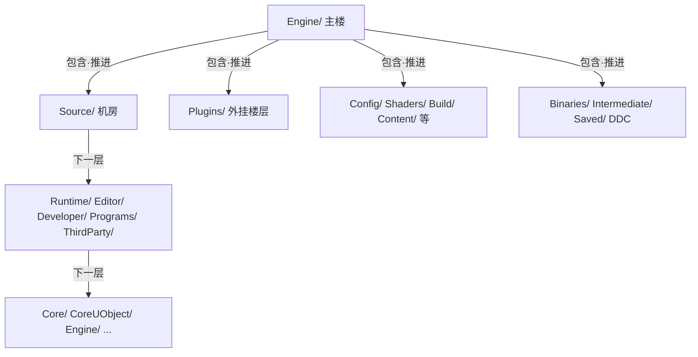

# 00 — `Engine/` 这一层总 md（为什么 + 全景 + 落点 + 进度）

> **定位**：本文件是 `从零复刻ue5\Engine\` 这一层**自己**的总 md，不是上级总纲的替代品。
> **对应真实目录**：`D:\ue5\Epic Games\UE_5.6\Engine\`（2026-11-14 实查，14 个目录）。
> **本轮只建这一份**：讲清这一层是什么、有哪些目录、接下来怎么走，然后停等确认，不一次往下铺。

---

## 一、为什么先立这一层（先讲为什么）

`UE_5.6\` 顶层 6 项里，只有 `Engine/` 是引擎本体 —— **99% 的代码都在这栋主楼里**。顶层门牌立好后，必须先照原样把主楼的 14 扇门全部立起来，后面进哪一扇门都有确定落点；否则又会出现「文件乱放、后期整批移动」的老毛病。

**说个场景**：把整个 UE 安装想成一栋大楼 —— `UE_5.6\` 是门牌，`Engine/` 是主楼；`Source\` 是机房（C++ 源码），`Plugins\` 是外挂楼层，`Config\` 是物业设置表，`Shaders\` 是灯光脚本，`Content\` 是库房（内置资源），`Binaries\` 是已经装好的机器，`Intermediate\` / `Saved\` / `DerivedDataCache\` 是施工垃圾和缓存。复刻是先照图纸把 14 扇门一扇不少地立起来，再推门进去逐间照抄 —— 不是一上来就钻进某间房。

> **记忆点（考点）**：`Engine\` 下 **14 个目录一个都不能少**，名字一个字不改；顺序按真实目录推进，不按「我觉得哪个重要」重排。

---

## 二、两套路径别混（教程 md / 还原代码）

| 项 | 路径 | 放什么 |
|---|---|---|
| 引擎真实目录（唯一权威） | `D:\ue5\Epic Games\UE_5.6\Engine\` | 引擎原版 |
| **教程目录（AI 建 md）** | `AI_Learning_Notes\从零复刻ue5\Engine\` | **只有教学 md** |
| **还原目录（用户手写代码，2026-11-14 指定）** | `ue_5.6\Engine\` | **只有还原代码** |

两套目录都镜像引擎目录结构，但**内容绝不交叉**：本课的 `00_Engine_总md.md` 在教程目录里，还原出来的代码文件在还原目录里。
镜像规则：`Engine\<真实路径>` → `从零复刻ue5\Engine\<同名路径>`（讲义）/ → `ue_5.6\Engine\<同名路径>`（还原代码），**只换根，其余一字不动**。
本轮**只建教学 md，不动任何代码文件**（只教不写代码）。

---

## 二·补、属性教学台账（2026-11-16 新增）

> **`Engine\属性教学台账.md`** —— **只登记「教学还原源码」时讲过的属性**（答疑文件里用户主动问的**不算**）。
> 触发时机：教 `Core.Build.cs` / `Core_APL.xml` / `Public\` 各头文件… 这些**还原源码**的讲义时，逐行遇到的属性。
> 配套铁律：`教学经验_UE5复刻新对话必看\03_属性首次出现必须教学并登记.md`
> 当前已登记 **52 项**（全部来自 `01_Core.Build.cs_完整代码.md`）。

---

## 三、`Engine/` 14 个目录全景（实查，不是照抄旧笔记）

```
Engine/
├─ Binaries/            ← 编译产物：dll / pdb / py
├─ Build/               ← 构建脚本与平台打包资源
├─ Config/              ← 引擎默认配置（Base*.ini）
├─ Content/             ← 引擎内置资源（材质/UI/音效）
├─ DerivedDataCache/    ← DDC 派生数据缓存
├─ Documentation/       ← 离线文档（.udn）
├─ Extras/              ← 附加工具 / SDK / 脚本
├─ Intermediate/        ← 编译中间产物
├─ Platforms/           ← 各平台特定代码与配置
├─ Plugins/             ← 引擎级插件（GAS / EnhancedInput …）
├─ Programs/            ← 独立程序（UHT / ShaderCompileWorker …）
├─ Saved/               ← 运行时生成数据
├─ Shaders/             ← 着色器源码（.usf / .ush）
└─ Source/              ← ★ C++ 源码（Core / CoreUObject / Engine …）
```

| 目录 | 作用 | 实查规模 / 关键内容 | 教程 md 落点 | 状态 |
|---|---|---|---|---|
| `Binaries/` | 编译产物与工具 | 16353 文件（6501 `.dll` / 2637 `.py` / 1553 `.pdb`） | `Engine\Binaries\` | ⬜ 待教 |
| `Build/` | 构建脚本 | 83 文件；`BatchFiles\`(15 `.sh`/7 `.bat`)、`Windows\`、`Mac\`、`Build.version`、`InstalledBuild.txt`、`Target.cs.template` | `Engine\Build\` | ⬜ 待教 |
| `Config/` | 引擎默认配置 | 81 文件（72 `.ini` / 8 `.json` / 1 `.csv`）；`BaseEngine.ini`、`BaseGame.ini`、`BaseInput.ini`、`ConsoleVariables.ini` + 各平台子目录 | `Engine\Config\` | ⬜ 待教 |
| `Content/` | 内置资源 | 28465 文件（17312 `.res` / 5202 `.uasset` / 3630 `.png`） | `Engine\Content\` | ⬜ 待教 |
| `DerivedDataCache/` | DDC 缓存 | 安装态目录（内容随运行生成） | `Engine\DerivedDataCache\` | ⬜ 待教 |
| `Documentation/` | 离线文档 | 837 文件（673 `.udn` / 151 `.png`） | `Engine\Documentation\` | ⬜ 待教 |
| `Extras/` | 附加工具 | 552 文件（105 `.py` / 100 `.h` / 49 `.cpp` / 38 `.exe`） | `Engine\Extras\` | ⬜ 待教 |
| `Intermediate/` | 编译中间产物 | 11555 文件（8408 `.h` / 1434 `.obj` / 1099 `.lib`） | `Engine\Intermediate\` | ⬜ 待教 |
| `Platforms/` | 平台特定代码 | 83 文件（21 `.h` / 20 `.cs` / 17 `.cpp` / 8 `.uplugin`） | `Engine\Platforms\` | ⬜ 待教 |
| `Plugins/` | 引擎级插件 | 98584 文件；`Runtime\`(21072)、`Experimental\`(19108)、`VirtualProduction\`(14429)、`Animation\`(6107)、`MetaHuman\`(6080)、`FX\`(4283) … | `Engine\Plugins\` | ⬜ 待教 |
| `Programs/` | 独立程序 | 59 文件；20 个程序目录：`UnrealHeaderTool\`、`ShaderCompileWorker\`、`UnrealInsights\`、`UnrealPak\`、`CrashReportClient\` … | `Engine\Programs\` | ⬜ 待教 |
| `Saved/` | 运行时生成 | 安装态目录 | `Engine\Saved\` | ⬜ 待教 |
| `Shaders/` | 着色器源码 | 1143 文件（543 `.usf` / 526 `.ush`）；`Private\` / `Public\` / `Shared\` / `StandaloneRenderer\` + `Shaders.Build.cs` | `Engine\Shaders\` | ⬜ 待教 |
| `Source/` | ★ C++ 源码 | 63088 文件（27370 `.h` / 16732 `.hpp` / 12111 `.cpp`）；`Runtime` 17862、`ThirdParty` 31791、`Editor` 7511、`Developer` 3311、`Programs` 2611 + 2 个 `Target.cs` | `Engine\Source\` | 🟡 进行中（本层总 md 已建：`Engine\Source\00_Source_总md.md`） |
| 本文件 | 本层总 md | 1 md | `Engine\00_Engine_总md.md` | ✅ 已建 |

> ⚠️ **一比一不做省略**：上表 14 个目录**全部**要教、要建，包括 `Binaries` / `Intermediate` / `Saved` / `DerivedDataCache` 这类「产物 / 缓存」目录 —— 它们是引擎真实目录树的一部分，不因为「看起来是生成的」就自作主张跳过。展开到某个目录时，按该目录真实文件逐个确认怎么一比一复刻。
> 旧笔记写 `Engine/` 214480 文件、顶层只有 5 个目录；本次实查为 **220885 文件**、且 `Engine\` 下是 **14 个目录**，以本表为准。

---

## 四、关系图（文字版 + Mermaid）

**文字版**（箭头含义：`──包含──>` = 父目录指向子目录，**同时是教学推进方向**；**不表示依赖关系**）：

```
UE_5.6/ ──包含──> Engine/ ──┬──包含──> Source/   ──包含──> Runtime/ Editor/ Developer/ Programs/ ThirdParty/
                            ├──包含──> Plugins/  ──包含──> Runtime/ Experimental/ FX/ Animation/ ...
                            ├──包含──> Config/ Shaders/ Build/ Content/ Documentation/ Extras/ Platforms/ Programs/
                            └──包含──> Binaries/ Intermediate/ Saved/ DerivedDataCache/
```



> 方向统一：**从上到下 = 教学推进顺序（父 → 子）**；每层先建该层总 md，等确认再展开下一层。

---

## 五、教学节奏与下一步

1. **本轮只建这一份总 md**，停下等你说「懂了 / 下一步」。
2. ✅ **顺序已按你 2026-11-14 指令调整：先攻 `Source\`**（本层总 md 已建 `Engine\Source\00_Source_总md.md`）。其余 13 个目录**仍在上表、一个没删**，后续按你指定顺序补，不擅自跳过。
3. ✅ 两个 `Target.cs` 讲完后，按上轮建议进 `Runtime\`：本层总 md 已建 `Engine\Source\Runtime\00_Runtime_总md.md`（185 模块全景 + 实查规模 + 模块内部结构）。✅ 已按你指令进 `Core\`（总 md `Engine\Source\Runtime\Core\00_Core_总md.md` 已建）。**⏳ 下一步**：在 `Core\` 下选一个子目录/文件开讲（建议 `Public\`），等你定。
4. 每展开一个目录，同步更新本表状态与上级总纲 `00_学习路径总纲_按UE5真实目录自上而下.md` 的进度列（✅/🟡/⬜/⏳）。
5. 收到「下一步」先核对镜像目录里的文件是否真建好了再推进；讲义必须落成 md，不能只发聊天。
6. ✅ 还原目录已由用户 2026-11-14 指定：`ue_5.6\`；每次「下一步」先按 `01_下一步前先检查还原文件.md` 验收还原文件，全对才推进、有错不推进。

---

## 六、速查表 · 口诀 · 一句话白话总结

| 三要素 | 值 |
|---|---|
| 读什么 | `D:\ue5\Epic Games\UE_5.6\Engine\` 真实 14 个目录 |
| 笔记建到哪 | `AI_Learning_Notes\从零复刻ue5\Engine\`（一比一镜像，已建） |
| 还原代码建到哪 | `ue_5.6\Engine\`（用户 2026-11-14 指定） |

**口诀**：**十四扇门一扇不少，名字照抄不改；一层一总、读完一个建一个；源码机房在 `Source`，插件外挂在 `Plugins`；产物缓存也照立，不许自己跳。**

**一句话白话总结**：这一课就是把引擎主楼的 14 扇门原样立起来、认清每扇门后面装的是什么，然后按顺序一扇一扇推门进去照抄 —— 我讲你建，看懂一层再走下一层。
