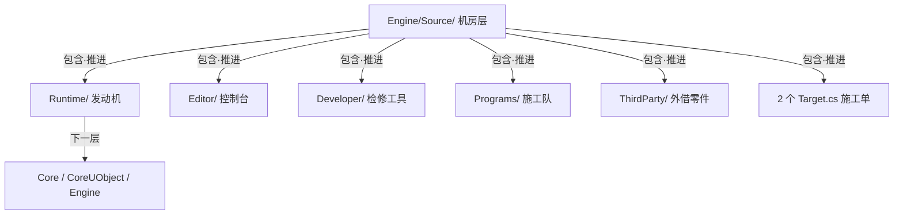

# 00 — `Engine/Source/` 这一层总 md（为什么 + 全景 + 落点 + 进度）

> **定位**：本文件是 `从零复刻ue5\Engine\Source\` 这一层**自己**的总 md，上级 `00_Engine_总md.md` 只是路线图，不能替代它。
> **对应真实目录**：`D:\ue5\Epic Games\UE_5.6\Engine\Source\`（2026-11-14 实查：**5 个分区 + 2 个 `Target.cs`**）。
> **本轮只建这一份**：讲清这一层是什么、里面有什么、下一步怎么走，然后停等确认。

---

## 一、为什么先攻这一层（先讲为什么）

`Engine\` 14 扇门里，`Source\` 是**唯一装 C++ 源码的机房**：UE 的三大基石（Core / CoreUObject / Engine）、编辑器、构建工具、第三方库全在这里。你指定先攻源码，那第一站就是它 —— 外面的 `Binaries` / `Config` / `Content` 等目录**仍留在 `00_Engine_总md.md` 的清单里，一个没删、没跳过**，后面按你指定顺序补。

**说个场景**：接着上一课的大楼比喻 —— `Source\` 就是主楼的机房层，分成 5 个房间：`Runtime\` 是让游戏跑起来的发动机，`Editor\` 是只有编辑器里才亮的控制台，`Developer\` 是检修与调试工具，`Programs\` 是楼外的施工队（UBT / AutomationTool），`ThirdParty\` 是外借的现成零件库（Boost / WebRTC / zlib）。机房门口还贴着两张施工单 —— 两个 `Target.cs`，告诉构建系统「这次要盖的是编辑器还是游戏」。

> **记忆点（考点）**：`Source\` 下 **5 个分区 + 2 个 `Target.cs`，一个都不能少**；分区名字一个字不改。两张施工单是 **C# 文件**（`using UnrealBuildTool;`），不是 C++。

---

## 二、两套路径别混（教程 md / 还原代码）

| 项 | 路径 | 放什么 |
|---|---|---|
| 引擎真实目录（唯一权威） | `D:\ue5\Epic Games\UE_5.6\Engine\Source\` | 引擎原版 |
| **教程目录（AI 建 md）** | `AI_Learning_Notes\从零复刻ue5\Engine\Source\` | **只有教学 md**（`00` / `01` / `02`） |
| **还原目录（用户手写代码，2026-11-14 指定）** | `ue_5.6\Engine\Source\` | **只有还原代码**（现有 `UnrealEditor.Target.cs`） |

两套目录都镜像引擎目录结构，但**内容绝不交叉**：讲义 md 在教程目录，还原 `.cs` 在还原目录。
镜像规则：`Source\<真实路径>` → `从零复刻ue5\Engine\Source\<同名路径>`（讲义）/ → `ue_5.6\Engine\Source\<同名路径>`（还原代码），**只换根，其余一字不动**。
本轮**只建教学 md，不动任何代码文件**（只教不写代码）。

---

## 三、`Source/` 全景清单（全部实查，不是照抄旧笔记）

```
Engine/Source/
├─ Runtime/        ← ★ 运行时：游戏跑起来要用的模块（上百个）
├─ Editor/         ← 编辑器模块（只在编辑器里跑）
├─ Developer/      ← 开发工具：调试/分析/打包/测试
├─ Programs/       ← 独立程序源码（UBT / AutomationTool / Shared …）
├─ ThirdParty/     ← 第三方库（Boost / WebRTC / Eigen / zlib …）
├─ UnrealEditor.Target.cs   ← 编辑器构建目标（C#，16 行）
└─ UnrealGame.Target.cs     ← 游戏构建目标（C#，17 行）
```

| 分区 | 作用 | 实查规模 | 重点内容（实查） | 教程 md 落点 | 状态 |
|---|---|---|---|---|---|
| `Runtime/` | 运行时核心，三大基石在这 | 17862 文件（10133 `.h` / 7015 `.cpp` / 268 `.cs` / 120 `.inl` / 71 `.c`） | `Engine` 3832、`Core` 1993、`CoreUObject` 856、`Renderer` 731、`Slate` 453、`UMG` 306、`GameplayTags` 27、`Launch` 34、`GameplayTasks` 21 | `Source\Runtime\` | 🟡 进行中（本层总 md 已建：`Source\Runtime\00_Runtime_总md.md`） |
| `Editor/` | 编辑器专用模块 | 7511 文件（4045 `.h` / 3309 `.cpp` / 144 `.cs`） | `UnrealEd` 1465、`Sequencer` 394、`Persona` 327、`AnimGraph` 317、`BlueprintGraph` 303、`PropertyEditor` 295、`DetailCustomizations` 311、`UMGEditor` 233 | `Source\Editor\` | ⬜ 待教 |
| `Developer/` | 开发工具与测试 | 3311 文件（1698 `.h` / 1403 `.cpp` / 165 `.cs` / 10 `.inl`） | `TraceInsights` 371、`Windows` 245、`TraceServices` 199、`DerivedDataCache` 99、`AssetTools` 65、`ShaderCompilerCommon` 35 | `Source\Developer\` | ⬜ 待教 |
| `Programs/` | 独立程序源码（多为 C#） | 2611 文件（1661 `.cs` / 204 `.dll` / 100 `.h` / 89 `.cache` / 73 `.pdb`） | `Shared` 1314、`AutomationTool` 697、`UnrealBuildTool` 431、`UnrealBuildAccelerator` 99、`LiveLinkHub` 42 | `Source\Programs\` | ⬜ 待教 |
| `ThirdParty/` | 第三方库 | 31791 文件（16732 `.hpp` / 11394 `.h` / 797 `.txt` / 605 `.c` / 400 `.ipp`） | `Boost` 15802、`WebRTC` 4346、`Licenses` 1140、`Unix` 1024、`Eigen` 697、`rpclib` 689、`asio` 622、`Android` 611 | `Source\ThirdParty\` | ⬜ 待教 |
| 本文件 | 本层总 md | 1 md | — | `Source\00_Source_总md.md` | ✅ 已建 |

### 两张「施工单」：`Target.cs`（已实读全文）

| 文件 | 真实内容（实读） | 作用 |
|---|---|---|
| `UnrealEditor.Target.cs` | 16 行；`UnrealEditorTarget : TargetRules`；`Type = TargetType.Editor`、`IncludeOrderVersion = Latest`、`BuildEnvironment = Shared`、`bBuildAllModules = true`、`ExtraModuleNames.Add("UnrealGame")` | 告诉 UBT：这次编的是**编辑器**，且把所有模块都编进来 |
| `UnrealGame.Target.cs` | 17 行；`[SupportedPlatforms(UnrealPlatformClass.All)]`；`UnrealGameTarget : TargetRules`；`Type = TargetType.Game`、`IncludeOrderVersion = Latest`、`BuildEnvironment = Shared`、`ExtraModuleNames.Add("UnrealGame")` | 告诉 UBT：这次编的是**游戏**，支持所有平台 |

> 这两个文件是 `Source\` 顶层**仅有**的两个散文件，用 C# 写、继承 `TargetRules`，由 UnrealBuildTool 读取。展开到它们时会一比一贴出完整内容（注释按口径中文化）。
> `Source\` 整个分区合计 63088 文件（27370 `.h` / 16732 `.hpp` / 12111 `.cpp` / 2378 `.cs` / 838 `.txt`）—— 与 `00_Engine_总md.md` 的实查数字一致。

---

## 四、关系图（文字版 + Mermaid）

**文字版**（箭头含义：`──包含──>` = 父目录指向子目录，**同时是教学推进方向**；**不表示依赖关系**）：

```
Engine/ ──包含──> Source/ ──┬──包含──> Runtime/    ──包含──> Core/ CoreUObject/ Engine/ ...
                            ├──包含──> Editor/     ──包含──> UnrealEd/ Sequencer/ Persona/ ...
                            ├──包含──> Developer/  ──包含──> TraceInsights/ AssetTools/ ...
                            ├──包含──> Programs/   ──包含──> UnrealBuildTool/ AutomationTool/ Shared/ ...
                            ├──包含──> ThirdParty/ ──包含──> Boost/ WebRTC/ Eigen/ ...
                            └──包含──> UnrealEditor.Target.cs + UnrealGame.Target.cs
```



> 方向统一：**从上到下 = 教学推进顺序（父 → 子）**；每层先建该层总 md，等确认再展开下一层。

---

## 五、教学节奏与下一步

1. **本轮只建这一份总 md**，停下等你说「懂了 / 下一步」。
2. **5 个分区 + 2 个 `Target.cs` 全都要教**，一个不删、不跳、不按「我觉得用不上」筛掉。
3. ✅ **已按你 2026-11-14 指令选定：先讲 `Source\` 顶层两个 `Target.cs`**，本课总 md 已建 `Source\01_两个Target文件_总md.md`（为什么 + 逐行大概讲 + 新符号 + 真实源码依据）。5 个分区仍全部保留、一个没删，后续按你指定顺序补。
4. ✅ **已交付** 两个 `Target.cs` 完整代码：`02_UnrealEditor.Target.cs_完整代码.md`（16 行）与 `03_UnrealGame.Target.cs_完整代码.md`（17 行），均含逐行扫描自检；✅ 已按建议进 `Runtime\`，本层总 md `Source\Runtime\00_Runtime_总md.md` 已建。✅ 已按你指令进 `Core\`，本层总 md 已建 `Source\Runtime\Core\00_Core_总md.md`。**⏳ 下一步**：在 `Core\` 下选一个（`Public\` 建议 / `Core.Build.cs` / 其他三个目录），等你定。
5. 每展开一项，同步更新本表状态、`00_Engine_总md.md` 与根总纲的进度列（✅/🟡/⬜/⏳）。
6. 收到「下一步」先核对镜像目录里的文件是否真建好了再推进；讲义必须落成 md，不能只发聊天。
7. ✅ 还原目录已由用户 2026-11-14 指定：`ue_5.6\`；每次「下一步」先按 `01_下一步前先检查还原文件.md` 验收还原文件，全对才推进、有错不推进。

---

## 六、速查表 · 口诀 · 一句话白话总结

| 三要素 | 值 |
|---|---|
| 读什么 | `D:\ue5\Epic Games\UE_5.6\Engine\Source\` 的 5 分区 + 2 个 `Target.cs` |
| 笔记建到哪 | `AI_Learning_Notes\从零复刻ue5\Engine\Source\`（一比一镜像，已建） |
| 还原代码建到哪 | `ue_5.6\Engine\Source\`（用户 2026-11-14 指定） |

**使用场景速记**：角色掉血要刷血条 → `Runtime\` 的 `UMG`/`Slate`；编辑器里拖蓝图节点 → `Editor\` 的 `BlueprintGraph`；点「编译」把工程编出来 → `Programs\` 的 `UnrealBuildTool`；项目里用到 JSON / zlib / Boost → `ThirdParty\`；决定「编编辑器还是编游戏」→ 两张 `Target.cs`。

**口诀**：**五个分区两张单，机房全在 `Source`；`Runtime` 跑、`Editor` 编、`Developer` 修、`Programs` 造、`ThirdParty` 借；三层基石 `Core` / `CoreUObject` / `Engine`，名字照抄不改。**

**一句话白话总结**：这一课把引擎机房的 5 个房间和门口 2 张施工单认清、原样立好，下一课你说进哪间，我就那间里再建一份总 md，我讲你建、看懂一层再走下一层。
