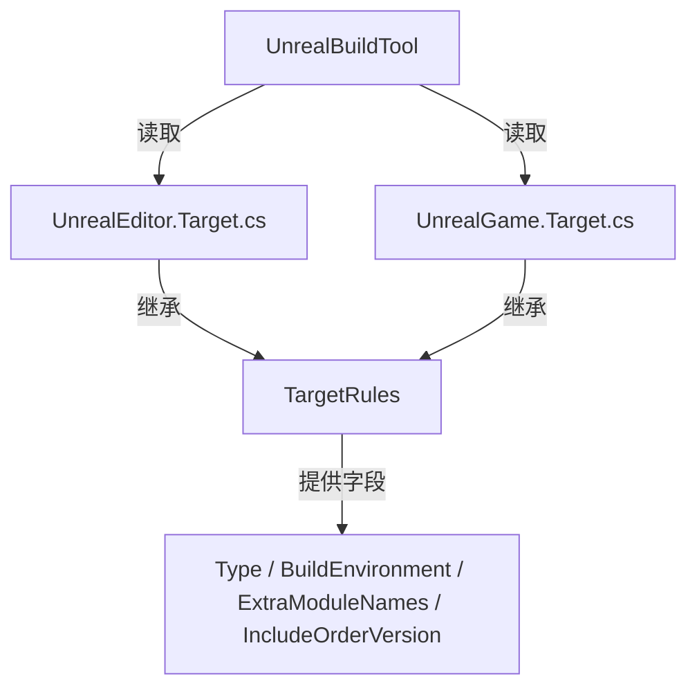

# 01 — 两个 `Target.cs` 总 md（施工单：编编辑器还是编游戏）

> **对应真实文件**：`D:\ue5\Epic Games\UE_5.6\Engine\Source\UnrealEditor.Target.cs`（实读 16 行）、`UnrealGame.Target.cs`（实读 17 行）。
> **本轮只建这一份总 md**：讲清为什么有它们、谁读它们、每一行大概干嘛；**完整代码留到下一步展开**，然后停等确认。

---

## 一、为什么先讲这两张「施工单」（先讲为什么）

UBT（UnrealBuildTool，编译施工队）开工前必须先知道一件事：**这次要盖的是「编辑器」还是「游戏」**。这两个 `.cs` 就是贴在 `Source\` 机房门口的两张施工单 —— 一张写「盖编辑器，所有模块都编进来」，一张写「盖游戏，支持所有平台」。

**说个场景**：你在 VS 里点「编译 UnrealEditor」→ 施工队读第一张单；打包游戏点「编译 UnrealGame」→ 读第二张单。没有单子，施工队连要盖什么都不知道。它们不写任何游戏逻辑，只**声明构建目标**，所以最短、最适合作为我们第一份吃透的完整文件。

> **记忆点（考点）**：它们是 **C# 文件**（`using UnrealBuildTool;`），不是 C++；都继承 `TargetRules`；`Source\` 顶层**只有这两个散文件**，其余全是 5 个分区目录。

---

## 二、谁读它们（真实源码依据，不凭脑子讲）

| 依据 | 真实位置（实查） |
|---|---|
| 编译施工队本体 | `Engine\Source\Programs\UnrealBuildTool\`（431 文件，272 `.cs`） |
| 两张单子继承的基类 | `Configuration\TargetRules.cs:528` → `public abstract partial class TargetRules` |
| `TargetType` 枚举 | `TargetRules.cs:20` |
| `TargetBuildEnvironment` 枚举 | `TargetRules.cs:77` |
| `EngineIncludeOrderVersion` 枚举 | `TargetRules.cs:168` |
| `ExtraModuleNames` 字段 | `TargetRules.cs:2716` → `public List<string> ExtraModuleNames { get; } = new();` |
| `[SupportedPlatforms]` 特性类 | `System\SupportedPlatformsAttribute.cs:12` |
| `UnrealPlatformClass` 枚举 | `Configuration\UEBuildTarget.cs:1039` |

**关系图**（箭头含义：`──读──>` = UBT 读取目标声明；`──继承──>` = 类继承；**不表示依赖链**）：

```
UnrealBuildTool（施工队）
   ├──读──> UnrealEditor.Target.cs ──声明──> Type=Editor / bBuildAllModules=true
   └──读──> UnrealGame.Target.cs   ──声明──> Type=Game / SupportedPlatforms(All)
                    两张单子 ──继承──> TargetRules（TargetRules.cs:528）
                                       └──提供──> Type / BuildEnvironment / ExtraModuleNames …
```



---

## 三、逐行大概讲（两张单子对照，行号为实读行号）

| 行 | `UnrealEditor.Target.cs` | `UnrealGame.Target.cs` | 大概干嘛用（详细留到展开） |
|---|---|---|---|
| 1 | `// Copyright Epic Games, Inc. All Rights Reserved.` | 同左 | 版权声明 |
| 3 | `using UnrealBuildTool;` | 同左 | 引入 UBT 的 `TargetRules` 等类型 |
| 4 | `using System.Collections.Generic;` | 同左 | 引入 C# 泛型容器 |
| 6 | —（无） | `[SupportedPlatforms(UnrealPlatformClass.All)]` | 声明这个目标支持所有平台类别 |
| 6 / 7 | `public class UnrealEditorTarget : TargetRules` | `public class UnrealGameTarget : TargetRules` | 类名 = 目标名，UBT 按它找单子；继承基类拿到全部构建字段 |
| 8 / 9 | `public UnrealEditorTarget( TargetInfo Target ) : base(Target)` | `public UnrealGameTarget( TargetInfo Target ) : base(Target)` | 构造函数把「当前要编的平台/配置」交给基类 |
| 10 / 11 | `Type = TargetType.Editor;` | `Type = TargetType.Game;` | **最核心的一行**：告诉 UBT 编编辑器还是编游戏 |
| 11 / 12 | `IncludeOrderVersion = EngineIncludeOrderVersion.Latest;` | 同左 | 用最新的 include 顺序规则（UE5.6 的新规范） |
| 12 / 13 | `BuildEnvironment = TargetBuildEnvironment.Shared;` | 同左 | 用共享构建环境（引擎模块可复用） |
| 13 | `bBuildAllModules = true;` | —（无） | 编辑器要把**所有模块**都编进来，游戏不需要 |
| 14 / 15 | `ExtraModuleNames.Add("UnrealGame");` | `ExtraModuleNames.Add("UnrealGame");` | 两个目标都额外带上 `UnrealGame` 模块 |

### 两张单子只有 3 处不同

| 差异点 | 编辑器单 | 游戏单 | 为什么 |
|---|---|---|---|
| `[SupportedPlatforms(...All)]` | 无 | 有 | 游戏包要能面向所有平台类别 |
| `Type` | `TargetType.Editor` | `TargetType.Game` | 目标类型本身不同 |
| `bBuildAllModules` | `true` | 不写 | 编辑器需要全部工具模块，游戏只编用到的 |

> 其余字段两边**一模一样** —— 这正是「两张单子」好懂的地方：只改 3 个开关，就从「编编辑器」变成「编游戏」。

---

## 四、本课新符号先教一遍（够用就好）

| 符号 | 真实出处 | 一句话作用 |
|---|---|---|
| `TargetRules` | `TargetRules.cs:528` | 所有构建目标声明的抽象基类，字段都从这里来 |
| `TargetInfo` | UBT 传入的构造参数 | 当前编译的平台 / 配置等信息 |
| `TargetType` | `TargetRules.cs:20` | 枚举：这次编的是 Game / Editor / Client / Server / Program |
| `TargetBuildEnvironment` | `TargetRules.cs:77` | 枚举：构建环境是共享还是独占 |
| `EngineIncludeOrderVersion` | `TargetRules.cs:168` | 枚举：include 顺序版本，`Latest` = 用最新规则 |
| `UnrealPlatformClass` | `UEBuildTarget.cs:1039` | 枚举：平台大类，`All` = 全平台 |
| `SupportedPlatformsAttribute` | `SupportedPlatformsAttribute.cs:12` | 特性：标在类上，声明该目标支持哪些平台 |
| `ExtraModuleNames` | `TargetRules.cs:2716` | `List<string>`，额外要编进来的模块名列表 |

---

## 五、教学节奏与下一步

1. **本轮只建这一份总 md**（为什么 + 逐行大概讲 + 新符号），停下等你说「懂了 / 下一步」。
2. ✅ **已交付**：`UnrealEditor.Target.cs` 完整 16 行 → `Source\02_UnrealEditor.Target.cs_完整代码.md`（一比一贴全 + 注释中文化 + 类/构造函数补中文注释 + 逐行扫描自检）；版权头按默认译成中文。
3. ✅ **已交付**：`UnrealGame.Target.cs` 完整 17 行 → `Source\03_UnrealGame.Target.cs_完整代码.md`（一比一贴全 + 注释中文化 + 逐行扫描自检；原文第 14 行空行也照抄）。两张施工单讲完。**⏳ 下一步**：回 `00_Source_总md.md` 的 5 分区清单，等你定先攻哪个。
4. 每教一步同步更新 `00_Source_总md.md`、`00_Engine_总md.md` 与根总纲的进度列；讲义必须落成 md，不能只发聊天。
5. ✅ 还原目录已由用户 2026-11-14 指定：`ue_5.6\`；每次「下一步」先按 `01_下一步前先检查还原文件.md` 验收还原文件，全对才推进、有错不推进。

---

## 六、速查表 · 口诀 · 一句话白话总结

| 三要素 | 值 |
|---|---|
| 读什么 | `Engine\Source\UnrealEditor.Target.cs`（16 行）+ `UnrealGame.Target.cs`（17 行） |
| 笔记建到哪 | `从零复刻ue5\Engine\Source\01_两个Target文件_总md.md`（本文件） |
| 谁用它们 | `Programs\UnrealBuildTool\`，基类 `TargetRules.cs:528` |

**使用场景速记**：点「编译编辑器」→ 走 Editor 单（`Type=Editor` + 全模块）；点「打包游戏」→ 走 Game 单（`Type=Game` + 全平台）；以后自己加游戏模块 → 往 `ExtraModuleNames` 里 `Add`。

**口诀**：**两张施工单，一个 `TargetRules`；只差三处开关 —— 平台标记、目标类型、全模块；其余全一样，C# 不是 C++。**

**一句话白话总结**：这两个文件就是给编译施工队看的两张纸条，一张说「盖编辑器、全编」，一张说「盖游戏、全平台」，剩下的话都从 `TargetRules` 基类继承来 —— 先看懂纸条，下一步再照着把第一张一字不差地抄下来。
