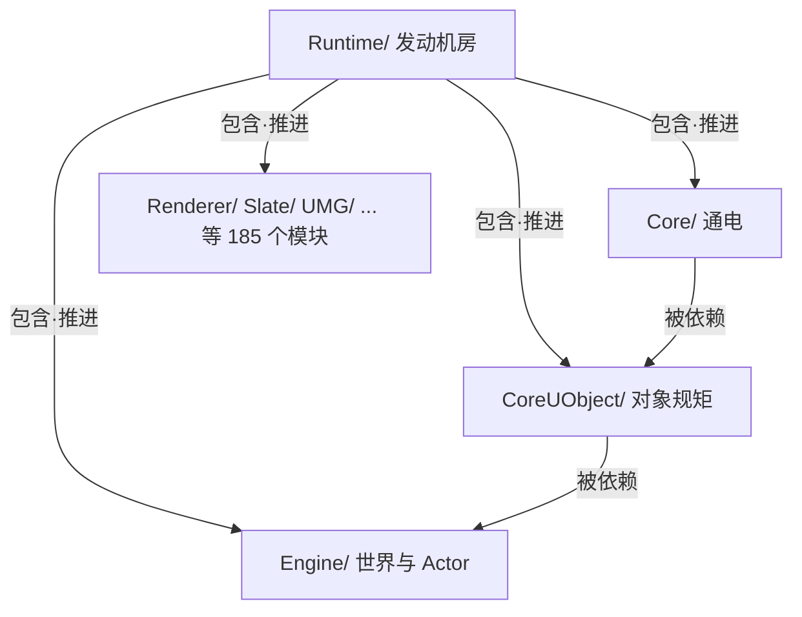

# 00 — `Engine/Source/Runtime/` 这一层总 md（为什么 + 全景 + 落点 + 进度）

> **定位**：本文件是 `从零复刻ue5\Engine\Source\Runtime\` 这一层**自己**的总 md，上级 `00_Source_总md.md` 只是路线图，不能替代它。
> **对应真实目录**：`D:\ue5\Epic Games\UE_5.6\Engine\Source\Runtime\`（2026-11-14 实查：**185 个模块目录、17862 文件**）。
> **本轮只建这一份**：讲清这一层是什么、里面有什么、下一步怎么走，然后停等确认。

---

## 一、为什么先攻 `Runtime\`（先讲为什么）

`Source\` 五个分区里，`Runtime\` 是**唯一让游戏真正跑起来的发动机房**：三大基石 `Core`（容器/字符串/数学/平台抽象）、`CoreUObject`（UObject 反射/GC/序列化）、`Engine`（Actor/World/组件/渲染骨架）全在这里。没有它，`Editor\` 的控制合、`Programs\` 的施工队、游戏逻辑都无从谈起。

**说个场景**：接着机房的比喻 —— `Source\` 是整层机房，`Runtime\` 是里面最核心的那排机柜。开机时先由 `Core` 通电（内存、日志、平台），`CoreUObject` 把「对象」这套规矩立起来（反射、GC、序列化），`Engine` 再让世界、Actor、组件转起来；`Renderer`/`Slate`/`UMG` 负责把画面和 UI 送出来，`PakFile`/`AssetRegistry` 负责找资源，`Online`/`Sockets` 负责联网。

> **记忆点（考点）**：`Runtime\` = 运行时模块集合，**每个模块都是一个独立编译单元**，由自己的 `<模块名>.Build.cs` 向 UBT 声明；185 个目录一个都不能少，名字一个字不改。

---

## 二、两套路径别混（教程 md / 还原代码）

| 项 | 路径 | 放什么 |
|---|---|---|
| 引擎真实目录（唯一权威） | `D:\ue5\Epic Games\UE_5.6\Engine\Source\Runtime\` | 引擎原版 |
| **教程目录（AI 建 md）** | `e:\ue5\game_design\code\ue5Learing\AI_Learning_Notes\从零复刻ue5\Engine\Source\Runtime\` | **只有教学 md** |
| **还原目录（用户手写代码）** | `e:\ue5\game_design\code\ue5Learing\ue_5.6\Engine\Source\Runtime\` | **只有还原代码** |

映射规则：`Runtime\<真实路径>` → `ue_5.6\Engine\Source\Runtime\<同名路径>`（还原）/ → `从零复刻ue5\Engine\Source\Runtime\<同名路径>`（讲义），**只换根，其余一字不动**。
本轮**只建教学 md，不动任何代码文件**（只教不写代码）。

---

## 三、`Runtime/` 全景清单（全部实查，不是照抄旧笔记）

### 每个模块目录长什么样（实查 `Core\` 与 `CoreUObject\`）

```
Core/                          CoreUObject/
├─ Public/      1196 文件      ├─ Public/      421 文件   ← 对外头文件，别的模块能 include
├─ Private/     642 文件       ├─ Private/     389 文件   ← .cpp 实现，只给自己用
├─ Internal/     29 文件       ├─ Internal/     20 文件   ← 内部头
├─ Tests/       124 文件       ├─ Tests/        25 文件   ← 测试代码
├─ Core.Build.cs               ├─ CoreUObject.Build.cs    ← UBT 的模块声明（依赖/包含路径）
└─ Core_APL.xml                （无）                     ← 平台附加文件（Android 用）
```

> `.Build.cs` 是**每个模块必备**的 C# 文件，作用和上一课两张 `Target.cs` 是同一套 UBT 体系：一个声明「构建目标」，一个声明「模块怎么编、依赖谁」。这份先大概讲，展开到某个模块时再逐个拆。

### 重点模块（实查规模，全部要教）

| 模块 | 规模 | 作用（一句话） |
|---|---|---|
| `Core/` | 1993 文件（1248 `.h` / 685 `.cpp`） | 三大基石之一：容器、字符串、数学、日志、平台抽象、内存 |
| `CoreUObject/` | 856 文件（484 `.h` / 362 `.cpp`） | 三大基石之二：UObject、反射、GC、序列化、包加载 |
| `Engine/` | 3832 文件（2287 `.h` / 1517 `.cpp`） | 三大基石之三：Actor / World / Component / 渲染骨架 / 游戏框架 |
| `Experimental/` | 1693 文件 | 实验性模块集合 |
| `Renderer/` | 731 文件 | 渲染管线实现 |
| `Online/` | 544 文件 | 在线服务与平台接口 |
| `MovieScene/` + `MovieSceneTracks/` | 483 + 374 | 序列动画（Sequencer）运行时 |
| `Slate/` + `SlateCore/` | 453 + 308 | 底层 UI 框架 |
| `AIModule/` | 387 文件 | AI / 行为树 / 寻路 |
| `UMG/` | 306 文件 | 基于 Slate 的 UMG UI |
| `Datasmith/` · `GeometryCore/` · `RenderCore/` | 305 · 302 · 182 | 数据导入 / 几何 / 渲染公共层 |
| `InteractiveToolsFramework/` | 218 文件 | 交互工具框架 |
| `ApplicationCore/` · `SignalProcessing/` | 189 · 181 | 应用窗口输入 / 音频信号处理 |
| `Landscape/` · `NavigationSystem/` | 136 · 107 | 地形 / 导航系统 |
| `RHI/` · `D3D12RHI/` · `VulkanRHI/` | 97 · 102 · 83 | 渲染硬件接口与各图形 API 后端 |
| `GameplayTags/` · `Launch/` · `InputCore/` | 27 · 34 · 21 | 标签系统 / 启动入口 / 输入 |
| `AssetRegistry/` · `PakFile/` · `Json/` | 44 · 19 · 30 | 资源登记 / 打包文件 / JSON |

### 完整模块目录清单（实查 185 个，一个不删、全部纳入推进计划）

```
AdpcmAudioDecoder  AdvancedWidgets  Advertising  AIModule  Analytics  Android
AnimationCore  AnimGraphRuntime  AppFramework  Apple  ApplicationCore  AssetRegistry
AudioAnalyzer  AudioCaptureCore  AudioCaptureImplementations  AudioDeviceEnumeration
AudioExtensions  AudioLink  AudioMixer  AudioMixerCore  AudioPlatformConfiguration
AudioPlatformSupport  AugmentedReality  AutomationMessages  AutomationTest
AutomationWorker  AutoRTFM  AVEncoder  AVIWriter  BinkAudioDecoder  BlueprintRuntime
BuildSettings  Cbor  CEF3Utils  CinematicCamera  ClientPilot
ClothingSystemRuntimeCommon  ClothingSystemRuntimeInterface  ClothingSystemRuntimeNv
ColorManagement  CookOnTheFly  Core  CoreOnline  CorePreciseFP  CoreUObject
CrashReportCore  CUDA  D3D12RHI  Datasmith  DeveloperSettings  Engine
EngineMessages  EngineSettings  Experimental  ExternalRPCRegistry  EyeTracker
FieldNotification  Foliage  FriendsAndChat  GameMenuBuilder  GameplayDebugger
GameplayMediaEncoder  GameplayTags  GameplayTasks  GeometryCore  GeometryFramework
HardwareSurvey  HeadMountedDisplay  IESFile  ImageCore  ImageWrapper  ImageWriteQueue
InputCore  InputDevice  InstallBundleManager  Instrumentation
InteractiveToolsFramework  Interchange  IOS  IPC  Json  JsonUtilities  Landscape
Launch  LevelSequence  Linux  LiveLinkAnimationCore  LiveLinkInterface
LiveLinkMessageBusFramework  MassEntity  MaterialShaderQualitySettings  MathCore
Media  MediaAssets  MediaUtils  MeshConversion  MeshConversionEngineTypes
MeshDescription  MeshUtilitiesCommon  Messaging  MessagingCommon  MessagingRpc
MoviePlayer  MoviePlayerProxy  MovieScene  MovieSceneCapture  MovieSceneTracks
MRMesh  NavigationSystem  Navmesh  Net  NetworkFile  NetworkFileSystem
Networking  NetworkReplayStreaming  NNE  NonRealtimeAudioRenderer  NullDrv
NullInstallBundleManager  Online  OodleDataCompression  OpenColorIOWrapper
OpenGLDrv  OpusAudioDecoder  Overlay  PacketHandlers  PakFile  PerfCounters
PhysicsCore  PlatformThirdPartyHelpers  Portal  PreLoadScreen  Projects
PropertyPath  RadAudioCodec  RawMesh  RenderCore  Renderer
RewindDebuggerRuntimeInterface  RHI  RHICore  RSA  RuntimeAssetCache  SandboxFile
Serialization  SessionMessages  SessionServices  SignalProcessing
SkeletalMeshDescription  Slate  SlateCore  SlateNullRenderer  SlateRHIRenderer
Sockets  Solaris  SoundFieldRendering  StateStream  StaticMeshDescription
StorageServerClient  StorageServerClientDebug  StreamingFile  StreamingPauseRendering
StudioTelemetry  SymsLib  SynthBenchmark  TextureUtilitiesCommon  TimeManagement
Toolbox  TraceLog  TypedElementFramework  TypedElementRuntime  UEJpegComp
UELibrary  UEWavComp  UMG  UniversalObjectLocator  Unix  UnrealGame  VectorVM
VerseCompiler  VirtualFileCache  VirtualProduction  VorbisAudioDecoder  VulkanRHI
WebBrowser  WebBrowserTexture  WidgetCarousel  Windows  XmlParser
```

> `Runtime\` 合计 17862 文件（10133 `.h` / 7015 `.cpp` / 268 `.cs` / 120 `.inl` / 71 `.c`），与 `00_Source_总md.md` 的实查数字一致。
> 表中没有标注规模的目录同样是真实模块，**同样要教、要还原**，不因为「小」或「看起来没用」跳过。

---

## 四、关系图（文字版 + Mermaid）

**文字版**（箭头含义：`──包含──>` = 父目录指向子目录，**同时是教学推进方向**；`──依赖──>` 仅表示模块间的真实依赖，**不是教学顺序**）：

```
Engine/Source/ ──包含──> Runtime/ ──┬──包含──> Core/          ──包含──> Public/ Private/ Internal/ Tests/ Core.Build.cs
                                    ├──包含──> CoreUObject/   ──依赖──> Core/
                                    ├──包含──> Engine/        ──依赖──> Core/ CoreUObject/
                                    ├──包含──> Renderer/ Slate/ UMG/ MovieScene/ Online/ ...
                                    └──包含──> 其余 180 个模块
```



> 方向统一：**从上到下 = 教学推进顺序（父 → 子）**；依赖箭头只是说明「谁靠谁」，不拿来重排教学顺序。

---

## 五、教学节奏与下一步

1. **本轮只建这一份总 md**，停下等你说「懂了 / 下一步」。
2. **185 个模块目录全都要教、要还原**，一个不删、不跳、不按「我觉得用不上」筛掉。
3. ✅ **已按你 2026-11-14 指令先进 `Core\`**：本层总 md 已建 `Runtime\Core\00_Core_总md.md`（1993 文件全景 + `Public`/`Private`/`Internal`/`Tests` + `Core.Build.cs` 新符号）。**⏳ 下一步**：在 `Core\` 下选一个（`Public\` 建议 / `Core.Build.cs` / `Private` / `Internal` / `Tests`），等你定，不擅自开。
4. 每教一步同步更新 `00_Source_总md.md`、`00_Engine_总md.md` 与根总纲的进度列（✅/🟡/⬜/⏳）。
5. **下次「下一步」先验收还原文件**：本层还原落点为 `ue_5.6\Engine\Source\Runtime\`；展开到哪个模块，就验收那个模块下的还原文件，全对才推进、有错不推进。
6. 讲义必须落成 md，不能只发聊天。

---

## 六、速查表 · 口诀 · 一句话白话总结

| 三要素 | 值 |
|---|---|
| 读什么 | `D:\ue5\Epic Games\UE_5.6\Engine\Source\Runtime\`（185 模块 / 17862 文件） |
| 讲义建到哪 | `AI_Learning_Notes\从零复刻ue5\Engine\Source\Runtime\` |
| 代码还原到哪 | `ue_5.6\Engine\Source\Runtime\` |

**使用场景速记**：写 `FString` / `TArray` → `Core`；写 `UCLASS` / `UObject` / GC → `CoreUObject`；写 `AActor` / `UWorld` / 组件 → `Engine`；画 UI → `Slate` / `UMG`；改渲染 → `Renderer` / `RHI`；读 pak 包 → `PakFile`。

**口诀**：**`Runtime` 是发动机房，一百八十五个机柜一台不能少；`Core` 通电、`CoreUObject` 立规矩、`Engine` 转世界；每台机柜都有 `Public`、`Private` 和一张 `Build.cs`。**

**一句话白话总结**：这一课先把发动机房里 185 个机柜认清、原样立好，看懂每台机柜里都分成「对外头文件 / 实现 / 测试 / 一张模块声明单」，下一课你说进哪台，我就给那台再建一份总 md。
