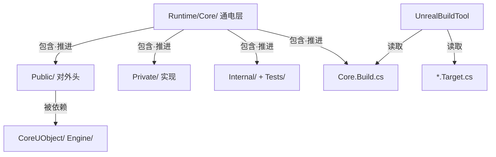

# 00 — `Runtime/Core/` 这一层总 md（为什么 + 全景 + 落点 + 进度）

> **定位**：本文件是 `从零复刻ue5\Engine\Source\Runtime\Core\` 这一层**自己**的总 md，上级 `00_Runtime_总md.md` 只是路线图，不能替代它。
> **对应真实目录**：`D:\ue5\Epic Games\UE_5.6\Engine\Source\Runtime\Core\`（2026-11-14 实查：**1993 文件**：1248 `.h` / 685 `.cpp` / 25 `.tps` / 23 `.inl` / 8 `.isph`）。
> **本轮只建这一份**：讲清这一层是什么、里面有什么、下一步怎么走，然后停等确认。

---

## 一、为什么先讲 `Core\`（先讲为什么）

三大基石里 `Core` 排第一，因为它是**通电那一层**：容器（`TArray`/`TMap`）、字符串（`FString`）、数学（`FVector`）、内存分配、日志、平台抽象（`HAL`/`GenericPlatform`）、断言、委托，全在这。`CoreUObject` 和 `Engine` 都建立在它上面 —— 没有 `FString`，连 UObject 的名字都存不了。

**说个场景**：开机时 `Launch` 把电闸合上，第一个醒过来的就是 `Core`：它把内存分配器、日志系统、平台检测、线程与同步原语准备好，之后 `CoreUObject` 才能建立 UObject/GC 规矩，`Engine` 才能创建 World 和 Actor。所以复刻顺序从它开始最顺。

> **记忆点（考点）**：`Core\` 是**一个模块**，由 `Core.Build.cs` 向 UBT 声明；目录里 `Public/` 对外、`Private/` 藏实现、`Internal/` 内部、`Tests/` 测试，另有 2 个散文件。名字一个字不改。

---

## 二、两套路径别混（教程 md / 还原代码）

| 项 | 路径 | 放什么 |
|---|---|---|
| 引擎真实目录（唯一权威） | `D:\ue5\Epic Games\UE_5.6\Engine\Source\Runtime\Core\` | 引擎原版 |
| **教程目录（AI 建 md）** | `e:\ue5\game_design\code\ue5Learing\AI_Learning_Notes\从零复刻ue5\Engine\Source\Runtime\Core\` | **只有教学 md** |
| **还原目录（用户手写代码，已建）** | `e:\ue5\game_design\code\ue5Learing\ue_5.6\Engine\Source\Runtime\Core\` | **只有还原代码** |

映射规则：`Core\<真实路径>` → `ue_5.6\Engine\Source\Runtime\Core\<同名路径>`（还原）/ → `从零复刻ue5\Engine\Source\Runtime\Core\<同名路径>`（讲义），**只换根，其余一字不动**。
本轮**只建教学 md，不动任何代码文件**（只教不写代码）。

---

## 三、`Core/` 全景清单（全部实查，不是照抄旧笔记）

### 顶层 6 项

```
Core/
├─ Public/         1196 文件  ← 对外头文件，别的模块能 include
├─ Private/         642 文件  ← .cpp 实现与内部头
├─ Internal/         29 文件  ← 内部专用头
├─ Tests/           124 文件  ← 单元测试
├─ Core.Build.cs              ← ★ 模块声明（C#，继承 ModuleRules，实读 299 行以上）
└─ Core_APL.xml               ← Android 平台附加文件（被 Build.cs 第 30 行引用）
```

| 顶层项 | 实查规模 / 关键内容 | 状态 |
|---|---|---|
| `Public/` | 1196 文件（1154 `.h` / 21 `.inl` / 13 `.tps` / 8 `.isph`），约 45 个子目录 + 7 个散头 | ⬜ 待教 |
| `Private/` | 642 文件（558 `.cpp` / 68 `.h` / 12 `.tps`），子目录与 `Public/` 大致对应 | ⬜ 待教 |
| `Internal/` | 29 文件；`IO\` 20、`CoreGlobalsInternal.h` 等 | ⬜ 待教 |
| `Tests/` | 124 文件（121 `.cpp` / 3 `.h`）；`Containers\` 20、`Misc\` 32、`Async\` 10、`String\` 10、`Math\` 9、`TestGroupEvents.cpp` | ⬜ 待教 |
| `Core.Build.cs` | C#，≥299 行；模块依赖 / 宏定义 / 平台分支 | ⬜ 待教 |
| `Core_APL.xml` | Android 平台附加 | ⬜ 待教 |
| 本文件 | 本层总 md | ✅ 已建 |

### `Public/` 子目录按用途分组（实查，全部要教）

| 组 | 目录（规模） | 大概装什么 |
|---|---|---|
| 容器 / 模板 / 算法 | `Containers` 73、`Templates` 80、`Algo` 44、`Traits` 12、`Concepts`、`Delegates` 12 | `TArray`/`TMap`、类型萃取、排序查找、委托 |
| 数学 | `Math` 99（83 `.h` / 8 `.isph`） | 向量、矩阵、四元数、随机数 |
| 字符串 / 国际化 | `String` 15、`Internationalization` 37 | `FString`/`FName` 基础、文本与本地化 |
| 平台抽象 | `HAL` 93、`GenericPlatform` 31、`Windows` 35、`Mac` 23、`Linux` 20、`Unix` 21、`IOS` 25、`Android` 28、`Apple` 20、`Microsoft` 14 | 平台层：内存、线程、文件、时间；各平台特化 |
| 杂项 / 工具 | `Misc` 181、`ProfilingDebugging` 35、`Stats` 18、`Logging` 12、`Async` 38、`IO` 12、`Serialization` 56、`Hash`、`Compression`、`Memory` | 断言/路径/配置、性能统计、日志、异步、序列化、压缩 |
| 与 UObject 的接口 | `UObject` 59（52 `.h` / 7 `.inl`） | Core 侧给 UObject 用的基础声明（注意：真正的 UObject 实现在 `CoreUObject\`） |
| 其他 | `Audio`、`AutoRTFM`、`Clang`、`ColorManagement`、`Experimental` 24、`Features`、`FileCache`、`FramePro`、`IntelICX`、`Modules`、`MSVC`、`Sanitizer`、`Tasks`、`Tests`、`Virtualization` | 各专项支持 |

**`Public/` 顶层 7 个散头文件**（实查）：`Core.h`、`CoreFwd.h`、`CoreGlobals.h`、`CoreMinimal.h`、`CoreSharedPCH.h`、`CoreTypes.h`、`PixelFormat.h` —— 是模块的总入口、前置声明、全局量、最小包含集、共享 PCH、基础类型与像素格式。
**`Private/` 顶层**：`CorePrivatePCH.h`（私有预编译头），子目录与 `Public/` 大致一一对应，另有 `Thirdparty\`。

### `Core.Build.cs` 新符号先教一遍（实读行号，够用就好）

| 符号 / 字段 | 真实行号 | 一句话作用 |
|---|---|---|
| `public class Core : ModuleRules` | 7 | 模块声明类（`Target.cs` 继承 `TargetRules`，这里继承 `ModuleRules`，同一套 UBT 体系） |
| `public Core(ReadOnlyTargetRules Target) : base(Target)` | 9 | 把当前编译目标交给基类 |
| `NumIncludedBytesPerUnityCPPOverride` | 11 | Unity 编译合批大小（491520 字节） |
| `PrivatePCHHeaderFile` / `SharedPCHHeaderFile` | 13 / 15 | 私有 / 共享预编译头 |
| `PrivateDependencyModuleNames` / `PublicDependencyModuleNames` | 17 / 39 | 私有 / 公有依赖模块（`BuildSettings`、`TraceLog`、`AtomicQueue`…） |
| `PrivateIncludePathModuleNames` / `PublicIncludePathModuleNames` | 43 / 54 | 只需头文件路径的模块 |
| `PrivateDefinitions` / `PublicDefinitions` | 69 / 113 | 编译时宏（`PLATFORM_*`、`UE_*`） |
| `AddEngineThirdPartyPrivateStaticDependencies` | 75 | 引入第三方静态库（zlib、IntelTBB、mimalloc…） |
| `PublicFrameworks` / `PublicSystemLibraries` | 123 / 209 | Apple 框架 / Unix 系统库 |
| `PublicDelayLoadDLLs` / `RuntimeDependencies` | 96 / 98 | 延迟加载 DLL / 运行时依赖 |
| `Target.Platform` / `Target.Configuration` / `Target.bBuildEditor` | 18 / 24 / 61 | 按平台、配置、是否编编辑器分叉 |
| `Target.Type == TargetRules.TargetType.Client` | 260 | 按目标类型分叉（呼应上一课两张 `Target.cs`） |

> 平台分支实读：`Android` 18–31、`Win64` 67–115、`Mac` 116–133、`IOS` 134–179、`Android 组` 180–200、`Unix` 201–220；另有 ICU 222–226、`bCompileAgainstEngine` 229、`bUseIris` 270 等通用段。
> ⚠️ 这个文件 ≥299 行，**本轮不贴完整代码**；展开到它时再一比一贴全（注释中文化、逐行扫描）。

---

## 四、关系图（文字版 + Mermaid）

**文字版**（箭头含义：`──包含──>` = 父目录指向子目录，**同时是教学推进方向**；`──被依赖──>` 只是真实依赖，**不拿来重排教学顺序**）：

```
Runtime/ ──包含──> Core/ ──┬──包含──> Public/   （对外声明：Containers/ Math/ HAL/ Misc/ ...）
                            ├──包含──> Private/  （实现，与 Public 大致对应）
                            ├──包含──> Internal/ Tests/
                            └──包含──> Core.Build.cs + Core_APL.xml

CoreUObject/ ──被依赖──> Core/      Engine/ ──被依赖──> Core/ + CoreUObject/
UnrealBuildTool ──读──> Core.Build.cs（模块声明） / *.Target.cs（目标声明）
```



---

## 五、教学节奏与下一步

1. **本轮只建这一份总 md**，停下等你说「懂了 / 下一步」。
2. **`Public` / `Private` / `Internal` / `Tests` / 2 个散文件全都要教、要还原**，一个不删、不跳。
3. **⏳ 下一步，等你定一个**：
   - 建议先 `Public\` 的总 md（45 个子目录 + 7 个散头，最常用、最能看懂 `Core` 提供什么）；
   - 或先 `Core.Build.cs` 的完整内容（一份文件、和刚学完的 `Target.cs` 连成一条线，最容易先吃透）；
   - 或 `Private` / `Internal` / `Tests`。
   > 我不擅自开，你说一个我就建那一层的总 md / 完整代码讲义。
4. 每教一步同步更新 `00_Runtime_总md.md`、`00_Source_总md.md`、`00_Engine_总md.md` 与根总纲的进度列。
5. **下次「下一步」先验收还原文件**：还原落点 `ue_5.6\Engine\Source\Runtime\Core\`；展开到哪个子目录/文件，就验收那一个，全对才推进、有错不推进。
6. 讲义必须落成 md，不能只发聊天。

---

## 六、速查表 · 口诀 · 一句话白话总结

| 三要素 | 值 |
|---|---|
| 读什么 | `D:\ue5\Epic Games\UE_5.6\Engine\Source\Runtime\Core\`（1993 文件） |
| 讲义建到哪 | `AI_Learning_Notes\从零复刻ue5\Engine\Source\Runtime\Core\` |
| 代码还原到哪 | `ue_5.6\Engine\Source\Runtime\Core\` |

**使用场景速记**：写 `TArray`/`TMap` → `Public\Containers`；写 `FString` → `Public\String`；写 `FVector` → `Public\Math`；查平台差异 → `Public\HAL` 与各平台目录；加日志 → `Public\Logging`；改模块依赖或宏 → `Core.Build.cs`。

**口诀**：**`Core` 先通电；`Public` 对外、`Private` 藏实现、`Internal` 内部用、`Tests` 验一遍；两张声明单 —— `Target.cs` 管目标，`Build.cs` 管模块。**

**一句话白话总结**：这一课把「通电层」的四个房间和门口那张模块声明单认清、原样立好，下一课你说进哪间，我就那间里再建一份总 md，我讲你建、看懂一层再走下一层。
